# RATCHET: a self-tightening constitution for GenLayer

A small assembly governs itself through a written **charter** of tiered articles. Every
motion (amend the charter, spend treasury funds, admit or expel a member) needs a
supermajority that depends on **how entrenched the articles it touches are**.

Whether a motion touches an article is a question of *meaning*, not of syntax, so GenLayer
validators answer it with an LLM, and the answer is binding only if the validators
reproduce it **exactly** (see [docs/CONSENSUS.md](docs/CONSENSUS.md)). A member who thinks the first reading
was too lenient can **challenge** it with a bond: the tier can be ratcheted **up, never down**,
and a successful challenger is paid a bounty out of the proposer's bond.

* Network: GenLayer **Studionet**
* Runtime: **GenVM v0.2.16** (stable), runner `py-genlayer:1jb45aa8ynh2a9c9xn3b7qqh8sm5q93hwfp7jqmwsfhh8jpz09h6`
* One contract file: [`contracts/Ratchet.py`](contracts/Ratchet.py) (no owner, no admin, no upgrade path, no oracle)

```bash
bash run.sh            # setup, lint, 190 tests, mutation proof, then a live Studionet run
```

---

## 1. The idea in one screen

```
 charter           A1 (tier 1)  A2 (tier 4)  A3 (tier 3)  A4 (tier 2)  ...
                      |             |             |            |
 motion  ---->   "does adopting this motion amend / repeal / override / contradict article X?"
                      |  (validators must give the SAME true/false for every article)
                      v
 tier = max(floor tier, tier of every touched article)          <- computed in code, never by the LLM
                      |
 votes needed = ladder(tier, frozen roster):
        tier 1 majority (> 1/2)   tier 2 two thirds   tier 3 four fifths   tier 4 unanimity
```

| Tier | Name | Votes needed (roster of 5 / 9) |
|---|---|---|
| 1 | ORDINARY | 3 / 5 (strict majority) |
| 2 | QUALIFIED | 4 / 6 (>= 2/3) |
| 3 | ENTRENCHED | 4 / 8 (>= 4/5) |
| 4 | FOUNDATIONAL | 5 / 9 (everyone) |

### Motion kinds and their floor tier

| Kind | Effect when enacted | Floor tier |
|---|---|---|
| `AMEND` | adopt a new article, replace one, or repeal one | the **current tier of the edited article** (new article: 1) |
| `GRANT` | pay commons funds to an address | by size: <= 10% of the treasury 1, <= 50% 2, more 3 |
| `ADMIT` | add a member | 2 |
| `EXPEL` | remove a member (never below 3 members) | 3 |

The edited article is not sent to the AI as a question (it already counts through the
floor); the AI answers for **every other** article. A grant for a political campaign, for
example, climbs to tier 3 because it contradicts an entrenched article, however small it is.

### Lifecycle (one motion on the floor at a time)

```mermaid
stateDiagram-v2
    [*] --> FILED: file_* (exact bond)
    FILED --> VOTING: classify  (AI, strict reading)
    FILED --> WITHDRAWN: withdraw_motion
    FILED --> EXPIRED: expire_motion (stale)
    VOTING --> LAPSED: close_vote, fewer than half voted
    VOTING --> REJECTED: close_vote, threshold missed
    VOTING --> CONTESTABLE: close_vote, threshold met
    CONTESTABLE --> CONTESTABLE: challenge (AI, inclusive reading; tier may only go up)
    CONTESTABLE --> ENACTED: finalize, still meets the (possibly higher) threshold
    CONTESTABLE --> REJECTED: finalize, no longer meets it
    CONTESTABLE --> VOID: finalize, effect no longer applicable
```



The **floor lock** (one active motion) means the charter, roster and treasury cannot change
between classification and settlement, so the frozen evidence the validators judge is
always the evidence the vote and the effect apply to.

### Money

All amounts are in wei of the native token. Payouts are **pull payments** (`withdraw`), so a
failing recipient can never block the assembly.

| Event | What happens |
|---|---|
| filing | proposer attaches **exactly** the bond (held in escrow) |
| motion ENACTED / REJECTED / VOID / WITHDRAWN / EXPIRED | bond returns to the proposer |
| motion LAPSED (fewer than half the roster voted) | bond is **forfeited to the treasury** |
| challenge **raises** the tier | challenger gets their bond back **plus half of the proposer's bond**; the other half returns to the proposer |
| challenge **fails** (tier unchanged) | half the challenger's bond compensates the proposer, half goes to the treasury |
| `donate` | straight to the treasury |
| `GRANT` enacted | treasury -> recipient's pull balance |
| bounced payout (`__on_errored_message__`) | returns to the treasury; nothing is ever lost |

`get_ledger` exposes the conservation law that every test and the live run check:
`balance >= treasury + escrow + sum(claimable)`, and equal once payouts have finalized.

---

## 2. The validator rule (the part that matters)

> Anything stored, counted, or deciding a path or a payout (statuses, booleans, scores, levels)
> must be **exactly equal** between leader and validator. No tolerance, no "one level stricter",
> no adjacent level. Flexible comparison exists **only** for the free-text `reason`.

How it is enforced and how it is proven is written down in [docs/CONSENSUS.md](docs/CONSENSUS.md). In short:

* validators assess **independently** (they never see the leader's answer) and approve only if
  the full per-article boolean map **and** the derived tier are identical;
* the level is **computed from the booleans in code**, then compared anyway and re-checked for
  consistency, so a forged level cannot ride on correct booleans;
* a leader error, a malformed answer, a validator exception: all are votes against;
* no consensus means no state change (**UNDETERMINED**), and the caller may retry;
* the suite checks all 16 x 16 leader/validator pairs, both adjacent-tier directions, 14 kinds of
  forgery, and 49 mutants (every tolerance-style mutant is killed).

---

## 3. Contract API

Addresses are accepted as `0x` hex strings, 20 raw bytes or `Address` objects and stored lower-case.

### Writes

| Method | Who | Payable | Notes |
|---|---|---|---|
| `__init__(name, founders, charter_json, bond, vote_minutes, challenge_minutes)` | deployer | no | 3-15 distinct founders; <= 12 articles `{"id","text","tier"}`; windows 2-10080 min |
| `file_amendment(article_id, new_text, new_tier)` | member | **bond** | existing id + empty text + tier `0` = repeal; unknown id = adopt (tier 1-4) |
| `file_grant(recipient, amount, purpose)` | member | **bond** | `0 < amount <= treasury` |
| `file_admission(candidate, statement)` | member | **bond** | candidate must not be a member; roster <= 15 |
| `file_expulsion(member, grounds)` | member | **bond** | roster stays >= 3 |
| `withdraw_motion(motion_id)` | proposer | no | only before classification |
| `expire_motion(motion_id)` | anyone | no | unclassified motion older than the vote window |
| `classify(motion_id)` | member | no | **AI consensus**, STRICT reading; opens the vote |
| `vote(motion_id, support)` | frozen-roster member | no | once; closed at the deadline |
| `close_vote(motion_id)` | anyone | no | when everyone voted, the deadline passed, or the motion is hopeless with >= half the roster voted. **A passing count never ends voting early.** |
| `challenge(motion_id)` | frozen-roster member except the proposer | **bond** | **AI consensus**, INCLUSIVE reading; once per motion |
| `finalize(motion_id)` | anyone | no | after the challenge window, or right after a challenge |
| `donate()` | anyone | value | to the treasury |
| `withdraw()` | anyone | no | pays the caller's whole pull balance |

### Views (all return JSON strings unless noted)

`get_assembly`, `get_charter`, `get_motion(id)`, `list_motions(offset, limit)` (limit <= 20),
`get_vote(id, voter)`, `get_claimable(address)`, `get_standing(address)`,
`get_ledger`, `quote_threshold(tier, roster_size) -> int`.

### Storage

Scalars: `name, bond, vote_minutes, challenge_minutes, charter_version, motion_count, floor_motion,
member_count, article_count, treasury, escrow, claimable_total` and seven `u32` counters.
Maps: `members`, `articles` (id -> JSON), `motions` (id -> JSON, self-contained: roster, charter
snapshot, evidence digest, touches, tier, votes, challenge), `votes`, `claimable`, `standing`.

---

## 4. Running everything

Requirements: Python 3.12+, Node 20+, network access. A GitHub Codespace works out of the box.

```bash
bash run.sh                # everything, ending with the live Studionet run
bash run.sh --fast         # skip the slow mutation suites
bash run.sh --offline      # everything, but the last step runs on the local simulator (no network)
bash run.sh --live-only    # only the live run (after a previous full setup)
bash run.sh --full         # live run plus the expiry scenario
```

| Step | What | Typical time |
|---|---|---|
| 1 | venv + pinned `genlayer-test 0.29.2`, `genvm-linter 0.11.0`, `pytest 8.4.2` | 1 min |
| 2 | downloads the **GenVM v0.2.16** artifacts, runs `genvm-lint` (`Lint passed`, `Validation passed`) | 1 min first time |
| 3 | `npm ci` (`genlayer-js 1.1.8`) and the script unit tests | 30 s |
| 4 | **190 Direct Mode tests** on the real v0.2.16 SDK | 40 s |
| 5 | **49 mutants** + the e2e self-check (10 broken contracts the live script must reject) | 3-8 min |
| 6 | **live end-to-end on Studionet** | 20-60 min (real consensus and real waiting windows) |

Flags of `node scripts/e2e.mjs`: `--sim`, `--chaos` (sim only), `--full`, `--ai-attempts N` (default 2; how often an AI
transaction may be re-sent after an UNDETERMINED consensus; the failed attempt must have changed nothing),
`--settle-minutes N`, `--payout-wait-minutes N`, `--payout-credit-seconds N`, `--fund-wait-seconds N`, `--contract <file>`.

Live accounts are throw-away keys generated into `.e2e/keys.json` (git-ignored). Each of the seven
accounts (`F0`-`F4`, `O`, `G`) must hold **0.1 GEN** (`E2E_MIN_GEN` changes that; the peak spend of one run is
about 0.045 GEN and the bonds come back). Funding:

```bash
npm run keys                          # create the accounts, show addresses and balances
npm run keys -- --fund --wait 600     # try sim_fundAccount, then wait up to 10 min for faucet transfers
```

Studionet often does not offer `sim_fundAccount`. That is not an error: the run (and `keys --fund --wait`) prints the
addresses that are short, **waits** for you to send GEN from the faucet in GenLayer Studio
(`--fund-wait-seconds`, default 600) and carries on as soon as the balances arrive. Accounts you already funded can
be reused with `E2E_KEYS="0xkey0,0xkey1,...,0xkey6"` (role order `F0,F1,F2,F3,F4,O,G`; never written to disk).
Reports land in `reports/latest.md` and `.json`.

**Studionet's RPC.** It allows 30 requests a minute and now and then answers with an HTML gateway page or
`"Internal error"`. `scripts/lib/throttle.mjs` wraps `fetch` for the RPC address, so it covers genlayer-js's own
polling too: calls are spaced at `E2E_RPC_PER_MIN` (default 24), a refused call is repeated after a pause, and a
*read* that hits a gateway error is repeated with a growing pause. A transaction submission is never repeated after a
gateway error (it may already have been accepted). Waiting for a receipt resumes after a transient failure instead of
aborting the run. `E2E_POLL_SECS` (default 15) is how often a pending transaction is looked up.

### What the live run does

| Section | Scenario | What is proven |
|---|---|---|
| Setup | fund 7 accounts, deploy, fetch the deployed source | deployed bytes equal the repo file |
| S0 | baseline reads | stored parameters, charter, threshold ladder 3/4/4/5 |
| S1 | four reverting calls | guards revert, no motion, no value kept |
| S2 | donation, filing, withdrawal | treasury, escrow, claimable accounting |
| S3 | adopt an article, unanimous vote, wait out the window | AI classification consensus, challenge window, enactment, payout arrives after finalization |
| S4 | motion whose text names A3, votes = threshold - 1 | the AI-derived tier moves the threshold; one vote short is rejected |
| S5 | indirect conflict, strict then inclusive reading | the **ratchet**: tier up, bounty routing, re-evaluated threshold |
| S5b | unrelated motion challenged anyway | failed challenge: compensation + commons share |
| S6 | grant to another account | size-based floor, treasury debit, payout arrives |
| S7 | admit a new member | roster grows, the new member can act |
| S8 | motion nobody votes on | LAPSED, bond forfeited to the commons |
| Final | reconciliation | stats equal the records, every stored classification is internally consistent, thresholds obeyed |
| Conservation | whole-run funds check | every account's balance equals `start - value attached + value withdrawn` to the wei, after waiting for delayed payouts; the contract ends holding exactly the treasury |

**Delayed payouts.** `emit_transfer` messages execute when the withdrawing transaction is *finalized*, not when it is
accepted. The ledger is therefore checked immediately (hard), the arrival of the money is awaited per scenario
(soft: `--payout-wait-minutes`, default 10, for the finalization, then `--payout-credit-seconds`, default 180, for the
credit to show) and re-checked for **every account at the end** (hard, `--settle-minutes`, default 10). If your
network finalizes more slowly, raise those numbers instead of re-running. If a withdraw *finalizes* and the recipient
is still not credited, the run notes it once and cuts the remaining waits short instead of polling for half an hour.

**Payouts to accounts use an EVM message.** An account lives on the chain layer, not in GenVM. `withdraw` therefore
pays through `@gl.evm.contract_interface class _Wallet` (an external `EthSend` message, the same way the Lumen
contract pays its claims). `gl.get_contract_at(addr).emit_transfer(...)` sends a GenVM-contract message instead; on
Studionet such a withdraw finalized and zeroed the ledger, but the recipient's `eth_getBalance` never moved. A test
(`test_withdraw_pays_an_account_with_an_evm_message_not_a_genvm_message`) and a mutant (`P-withdraw-genvm-message`)
pin this down.

**Hard vs soft checks.** An LLM is not under our control, so *what the AI says* is a soft
expectation (a warning if it differs, e.g. "the strict reading should flag A3"). Everything
the contract guarantees **about whatever consensus decided** is hard: the stored booleans cover
exactly the right articles, `tier = max(floor, touched tiers)`, thresholds follow the tier, bonds
and bounties route to the wei, money is conserved, and **a failed consensus changes nothing**.
The challenge scenarios are outcome-aware: whichever way the AI goes, the money must follow.

### Local dry run

`node scripts/e2e.mjs --sim` runs the **same script** against `scripts/sim_bridge.py`, which executes the real
contract on the real GenVM v0.2.16 SDK (Direct Mode) behind a tiny HTTP API: calldata is encoded by
`genlayer-js` and decoded by the SDK, reverts roll back value, a leader plus four validators must reach a
majority with the contract's real validator, and emitted transfers settle only 60 simulated seconds after
finalization. `--chaos` makes the first AI transaction fail consensus to exercise the retry path.
The AI is replaced by a deterministic keyword clerk (`SimClerk`). This is what lets the live script be debugged
before it ever touches the network.

---

## 5. Test inventory

| Suite | Count | What |
|---|---|---|
| `tests/direct` | 190 | constructor/filing/guards, classification, **consensus strictness**, voting & timing, challenge/ratchet, settlement, money, per-tier thresholds on a 9-member roster, defensive VOID paths, views, 30 randomized walks x 260 steps with 8 invariants after every step (including "a reverted call changes nothing") and a coverage guard |
| `tests/mutation/run_mutations.py` | 49 mutants | 48 killed, 1 documented equivalent |
| `tests/mutation/e2e_selfcheck.py` | 10 | the live script must fail against each broken contract |
| `scripts/test` | 7 | receipt classification (names/numbers, snake/camel case, errors, undetermined) |
| e2e `--sim` | 278 checks / 75 txs (281 / 76 with `--chaos`) | the whole live scenario on real contract code |

Direct Mode runs the contract's actual Python on the actual v0.2.16 SDK (storage, calldata, message
context) with the LLM and web mocked; it does not run the WASM VM. What it cannot show is how often real LLM
validators agree and how Studionet times things; that is exactly what the live run measures.

---

## 6. Security notes and limits

* **Not audited.** Treat it as a reference implementation.
* **The AI is a witness, not an authority.** It only answers true/false per article against frozen
  evidence; levels, thresholds and money are computed by code. The challenge game exists because a
  first reading can be wrong or manipulated; the motion text is passed as JSON data and the prompt tells the
  clerk to treat it as untrusted.
* **Floor squatting.** A member can occupy the floor for at most one vote window without classification
  (anyone can then `expire_motion`), or longer by classifying and not voting (the motion then LAPSES and the
  bond is forfeited). Members can also clear the floor themselves by voting.
* **Roster = sybil boundary.** Admission needs tier 2; expulsion tier 3; the roster is frozen per motion.
* **Payouts to contracts.** Payouts are `emit_transfer` messages (executed on finalization, as on any GenVM
  contract). A bounced payout is credited to the treasury by `__on_errored_message__`.
* **Time** comes from the transaction timestamp; windows are whole minutes (2 to 10080).
* **No upgrade, no admin.** Parameters are fixed at deployment; the charter itself changes only through motions.

---

## 7. Repository layout

```
contracts/Ratchet.py            the intelligent contract (GenVM v0.2.16)
docs/CONSENSUS.md               the exact-equality rule, evidence and trade-offs
tests/helpers.py                World (rollback, value, transfers, consensus emulation) + FakeClerk
tests/direct/                   Direct Mode suites (real SDK)
tests/mutation/                 mutation runner + e2e self-check
scripts/e2e.mjs                 live end-to-end (Studionet) / dry run (--sim)
scripts/lib/                    chain adapters, receipt classifier, keys, report writer
scripts/sim_bridge.py           local Studionet stand-in running the real contract
scripts/prepare_genvm.py        fetches the pinned GenVM v0.2.16 artifacts for the linter
run.sh                          one command for everything
```

Pins: GenVM `v0.2.16` - `genlayer-test==0.29.2` - `genvm-linter==0.11.0` - `genlayer-js@1.1.8` - Python 3.12+ - Node 20+.

## License

MIT, see [LICENSE](LICENSE).
